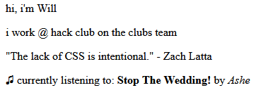
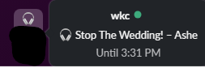

# Apple Music now-listening

| On your website | In your Slack status |
| :---: | :---: |
|  |  |

A script that allows your website and your Slack Status to be updated as you listen to Apple Music on the Windows App.

- **Slack:** your status becomes `🎧 Song – Artist` while music is playing, and goes back to whatever it was before when you stop.
- **Your website:** a small "Listening on Apple Music" card with the album art, which updates by itself.

You can use either one on its own, or both.

## How it works

```
Apple Music app ──▶ nowplaying.py ──┬──▶ Slack status
  (on Windows)     (on your PC)     │
                                    └──▶ Cloudflare Worker ──▶ your website
                                         (free, stores the      (fetches the song
                                          current song)          every 30 seconds)
```

`nowplaying.py` checks every couple of seconds what the Apple Music app is playing, using the same Windows media info that shows up on your lock screen and volume popup. It doesn't need an Apple Music API key or a developer account.

Your website can't talk to your PC directly, so the script sends the song to a tiny [Cloudflare Worker](https://workers.cloudflare.com/). The worker stores the song, and your website reads it from there. Workers are free for this kind of use.

## What you need

- **Windows 10 or 11** with the [Apple Music app](https://apps.microsoft.com/detail/9PFHDD62MXS1) from the Microsoft Store. iTunes doesn't work with this script.
- **Python 3.10 or newer** from [python.org](https://www.python.org/downloads/). Tick **"Add python.exe to PATH"** during the install.
- For Slack: a Slack workspace where you're allowed to install apps.
- For your website: a free [Cloudflare account](https://dash.cloudflare.com/sign-up). You don't need Node.js or Wrangler, because `deploy.py` handles the deploy.

## Setup

### 1. Download the code and install the requirements

```powershell
git clone https://github.com/glimmercharger/apple-music-now-listening.git
cd apple-music-now-listening
python -m pip install -r requirements.txt
```

(No git? Click the green **Code** button on GitHub, choose **Download ZIP**, unzip it, and open a terminal in that folder.)

### 2. Create your config file

Make a copy of `config.example.json` and name it `config.json`. All your tokens and secrets go in this file.

```powershell
copy config.example.json config.json
```

> [!IMPORTANT]
> `config.json` is in `.gitignore`, so git won't commit it. Never paste anything from it into your website, a screenshot or a public repo. If you fork this repo, double-check that `config.json` didn't get committed.

Here's what each setting does:

| Setting | Needed for | What it is |
| --- | --- | --- |
| `slack_token` | Slack | Your Slack user token (`xoxp-...`). See step 3. Delete the line or leave it empty to turn Slack off. |
| `slack_emoji` | Slack | The emoji shown while music is playing. Defaults to `:headphones:`. Custom workspace emoji work too. |
| `cloudflare_token` | Website | A Cloudflare API token, only used by `deploy.py`. See step 4. |
| `cloudflare_account_id` | Website | Optional. Only needed if your token can see more than one Cloudflare account. |
| `worker_name` | Website | Optional. The name of your worker, and part of its URL. Defaults to `nowplaying`. |
| `worker_secret` | Website | A password you make up. It stops anyone else from changing what your website shows. |
| `worker_url` | Website | Leave this empty. `deploy.py` fills it in. Leave it empty to turn the website part off. |

### 3. Set up Slack (optional)

1. Go to **[api.slack.com/apps](https://api.slack.com/apps)** → **Create New App** → **From scratch**. Give it any name (e.g. "Now Playing") and pick your workspace.
2. Open **OAuth & Permissions** in the sidebar. Scroll to **User Token Scopes** (not Bot Token Scopes) and add both of these:
   - `users.profile:read`
   - `users.profile:write`
3. Scroll back up and click **Install to Workspace**, then **Allow**. Some workspaces need an admin to approve the app first.
4. Copy the **User OAuth Token**, which starts with `xoxp-`, and paste it into `slack_token` in `config.json`.

Want to skip Slack? Remove the `slack_token` line, or set it to `""`.

### 4. Set up the Cloudflare Worker (optional, needed for your website)

1. Sign in to the [Cloudflare dashboard](https://dash.cloudflare.com/) and open **Workers & Pages** once. If it asks you to choose a `workers.dev` subdomain, pick one. It becomes part of your worker's URL.
2. Make an API token. Click your profile icon → **My Profile** → **API Tokens** → **Create Token**, then pick the **Edit Cloudflare Workers** template. Choose your account under *Account Resources*, then click **Continue to summary** → **Create Token**. Paste the token into `cloudflare_token`.
3. Make up a long random `worker_secret`. This command generates one for you:

   ```powershell
   python -c "import secrets; print(secrets.token_urlsafe(32))"
   ```

4. Deploy the worker:

   ```powershell
   python deploy.py
   ```

   It prints something like `deployed to https://nowplaying.your-name.workers.dev` and saves that URL into `worker_url` for you.

5. Open that URL in your browser. You should see `{"playing":false}`. That's the URL your website will use.

If you change `worker_secret` later, run `python deploy.py` again so the worker knows the new one.

### 5. Run it

```powershell
python nowplaying.py
```

Play something in Apple Music. Within a few seconds the terminal prints the song, your Slack status changes, and your worker URL shows the song. Press <kbd>Ctrl</kbd>+<kbd>C</kbd> to stop it.

### 6. Start it automatically when you log in

To run it in the background without a terminal window, start it with `pythonw.exe`, the windowless version of Python. When it runs like this, it writes its output to `nowplaying.log` in the project folder.

1. Find where `pythonw.exe` is:

   ```powershell
   python -c "import sys, pathlib; print(pathlib.Path(sys.executable).with_name('pythonw.exe'))"
   ```

2. Press <kbd>Win</kbd>+<kbd>R</kbd>, type `shell:startup` and press Enter. This opens your Startup folder.
3. Right-click → **New** → **Shortcut**. For the location, put the `pythonw.exe` path, a space, then the full path to `nowplaying.py`, both in quotes:

   ```
   "C:\Users\you\AppData\Local\Programs\Python\Python313\pythonw.exe" "C:\Users\you\apple-music-now-listening\nowplaying.py"
   ```

4. Name it `nowplaying` and click **Finish**. Then right-click the new shortcut → **Properties**, and set **Start in** to the project folder.

To start it now without logging out, double-click the shortcut. To stop it, end the `pythonw.exe` task in Task Manager.

## Adding it to your website

Your worker URL returns JSON, so any website can show it: plain HTML, GitHub Pages, Netlify, or a framework. There are two ways to do it.

### Option A: the ready-made card (easiest)

1. Copy [`web/now-playing.js`](web/now-playing.js) into your website's folder, next to your HTML file.
2. Put this where you want the card to appear:

   ```html
   <div data-now-playing></div>
   ```

3. Put this just before `</body>`, using your own worker URL:

   ```html
   <script src="now-playing.js" data-endpoint="https://nowplaying.your-name.workers.dev" defer></script>
   ```

That's it. While you're listening, the card shows the album art, song and artist, and clicking it opens the song on Apple Music. When you stop, the card says you're not listening to anything. It checks for a new song every 30 seconds, and pauses while the tab is in the background. [`web/example.html`](web/example.html) is a complete example page.

**Options:** add these to the `<script>` tag:

| Attribute | What it does |
| --- | --- |
| `data-endpoint="..."` | **Required.** Your worker URL. |
| `data-hide-when-idle` | Hides the card completely when nothing is playing. |
| `data-idle-text="..."` | Changes the text shown when nothing is playing. |
| `data-country="gb"` | The Apple Music country to look up album art and links in. Defaults to `us`. |

**Styling:** the card has light and dark versions built in. Its styles are as weak as CSS allows, so your own CSS always wins. To change the colours or size, override these variables:

```css
.np {
  --np-bg: #ffffff;      /* card background */
  --np-fg: #1d1d1f;      /* song title */
  --np-muted: #6e6e73;   /* artist */
  --np-accent: #fa2d48;  /* "Listening on Apple Music" label */
  --np-border: #e5e5ea;
  max-width: 360px;
}
```

The parts of the card have the classes `.np`, `.np-art`, `.np-label`, `.np-title` and `.np-artist`, so you can restyle any of them.

### Option B: build your own

You only need a `fetch` from your worker URL. This is the smallest version:

```html
<p id="now-playing">Loading…</p>

<script>
  async function updateNowPlaying() {
    const res = await fetch("https://nowplaying.your-name.workers.dev");
    const song = await res.json();
    document.getElementById("now-playing").textContent = song.playing
      ? `🎧 ${song.title} – ${song.artist}`
      : "Not listening to anything right now";
  }
  updateNowPlaying();
  setInterval(updateNowPlaying, 30000);
</script>
```

The worker returns this:

```json
{
  "playing": true,
  "title": "Party In the U.S.A.",
  "artist": "Miley Cyrus",
  "album": "The Time of Our Lives",
  "updated": 1793450000000
}
```

`updated` is when your PC last checked in, as a JavaScript timestamp in milliseconds. If your PC stops checking in for 3 minutes (closed lid, crash, no internet), `playing` switches to `false` by itself.

Use `textContent` (as above) rather than `innerHTML` when you show the song, so a strange song title can't break your page.

## How it behaves

- **Your old Slack status comes back.** If you had a status like "🌴 On holiday" before the music started, it's restored when you stop, with the same expiry time it had.
- **Other statuses win.** If you set a status yourself while music is playing (e.g. "📅 In a meeting"), the script leaves it alone until you clear it.
- **No status stuck forever.** The music status expires after 10 minutes unless the script renews it. If your PC dies mid-song, the status clears itself.
- **Crash-safe.** The status you had before the music is saved in `saved_status.json`, so it's still restored after a restart.
- **Network blips are fine.** If Slack or Cloudflare can't be reached, the script waits 30 seconds and tries again.
- **Only Apple Music counts.** Spotify, YouTube in your browser and other apps are ignored.

## Troubleshooting

| Problem | Fix |
| --- | --- |
| Nothing happens when music plays | Check that you're using the **Apple Music** app from the Microsoft Store, not iTunes. If it's running in the background, look in `nowplaying.log`. |
| `ModuleNotFoundError: No module named 'winrt'` | Run `python -m pip install -r requirements.txt` again with the same Python that runs the script. |
| `config.json needs a slack_token, a worker_url, or both` | Fill in at least one of them. See [step 2](#2-create-your-config-file). |
| `slack users.profile.set: missing_scope` | Add **both** user token scopes from [step 3](#3-set-up-slack-optional), then reinstall the app and copy the new token. |
| `slack ...: invalid_auth` or `not_authed` | The token is wrong or was revoked. Copy the **User** OAuth Token (`xoxp-`), not the Bot token. |
| `HTTP Error 401: Unauthorized` when updating the website | `worker_secret` doesn't match the deployed worker. Run `python deploy.py` again. |
| `deploy.py` fails on `/workers/subdomain` | Open **Workers & Pages** in the Cloudflare dashboard and choose a `workers.dev` subdomain, then run it again. |
| `deploy.py` fails on `/accounts` | Add `"cloudflare_account_id": "..."` to `config.json`. The ID is on the right of your Cloudflare dashboard home page. |
| The card on my website is empty | Open your browser's developer console (<kbd>F12</kbd>) and look for errors. Check that `data-endpoint` is your worker URL. |
| The album art is for the wrong song or missing | The art comes from Apple's public search, which finds the best match for the title and artist. Try setting `data-country` to your country. |

## Keeping your secrets safe

- Your Slack token, Cloudflare token and worker secret only ever go in `config.json` on your own PC. That file is git-ignored.
- Your website only needs the **worker URL**. The URL is public and read-only, so anyone who has it can see what you're listening to, which is the point. Only someone with your `worker_secret` can change it.
- If a token leaks, revoke it: reinstall the Slack app, or delete the token under Cloudflare's API Tokens. For a leaked worker secret, change `worker_secret` and run `python deploy.py` again.

## Project layout

```
nowplaying.py         the script that watches Apple Music (runs on your PC)
deploy.py             uploads the worker to Cloudflare
worker/src/index.js   the Cloudflare Worker that stores the current song
web/now-playing.js    the drop-in card for your website
web/example.html      an example page using the card
config.example.json   template for your config.json
```

## License

[MIT](LICENSE)
